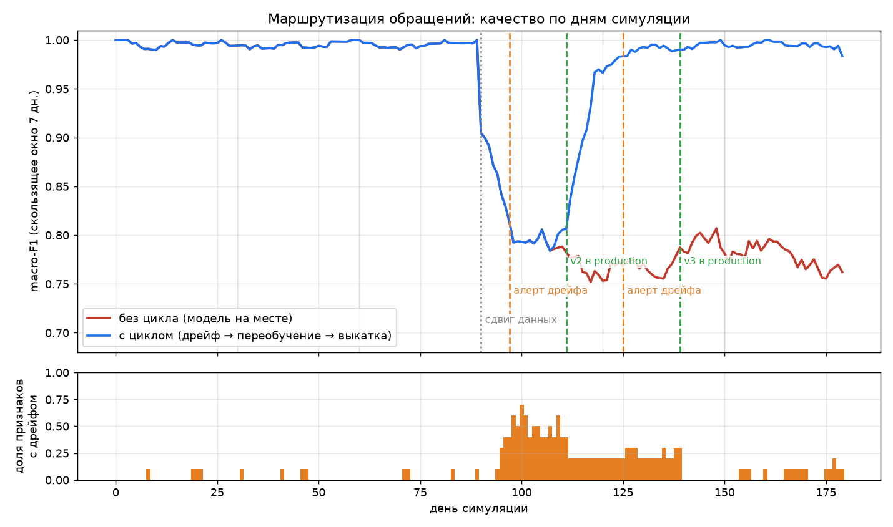
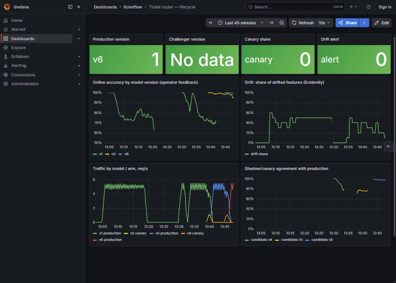
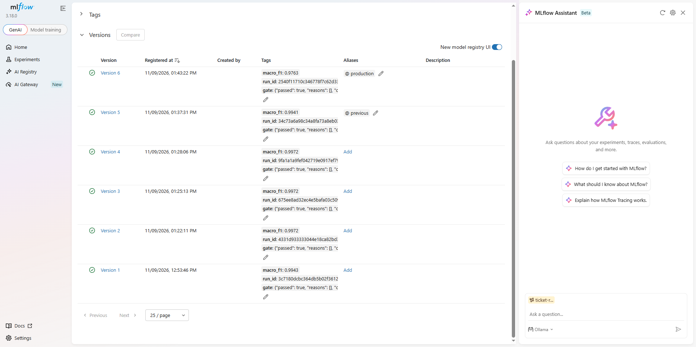
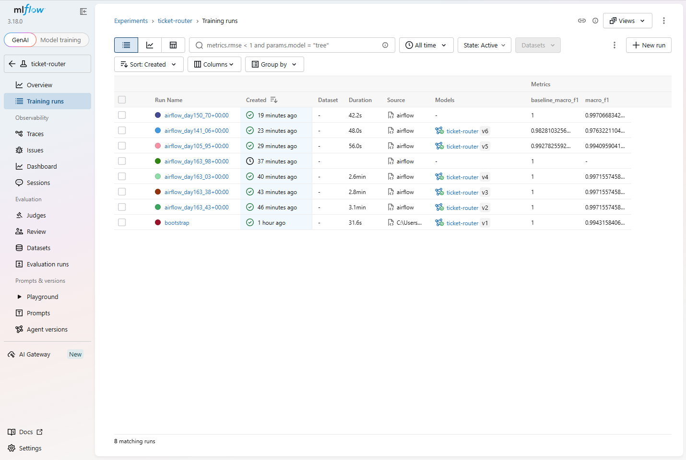
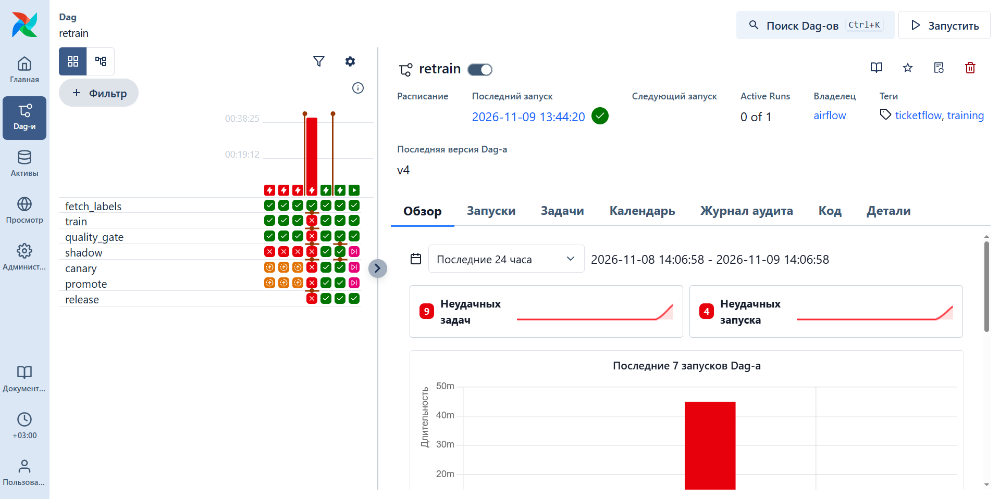
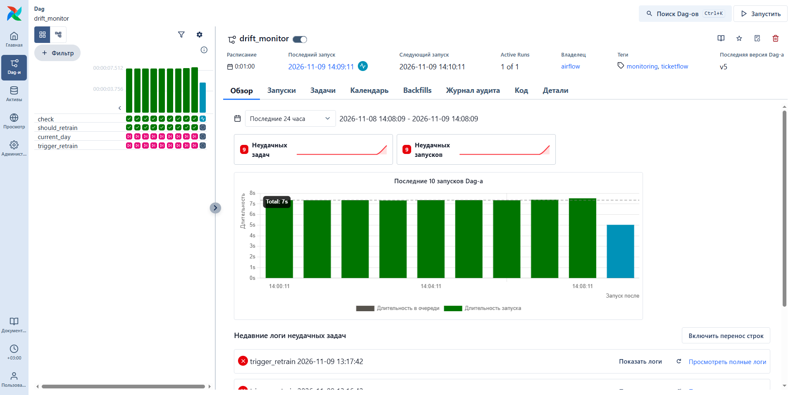

# Жизненный цикл модели маршрутизации обращений

[](https://github.com/Sinerror/ticket-router-mlops/actions/workflows/ci.yml)

Дрейф → переобучение → ворота качества → теневой запуск → канарейка → откат за секунду.

Классификатор обращений в поддержку (rubert-tiny2, 11 тем) сам по себе здесь не главное. Главное — управляемый цикл вокруг него: данные под версией, обучение, ворота качества, реестр моделей, shadow и canary, мониторинг дрейфа и переобучение по сигналу. Каждый шаг автоматизирован и измерен.



*Симуляция «полгода за 5 минут»: 180 дней по 50 обращений. На 90-й день появляется новая тема «возврат» (REFUND, 25% трафика), и клиенты начинают писать разговорно и с опечатками. Красная линия — модель, которую обучили один раз и оставили. Синяя — та же модель внутри цикла.*

## Результаты (все цифры из `make simulate` и `make benchmark`, seed 42)

| метрика | значение |
| --- | --- |
| macro-F1 до сдвига | 0.996 |
| macro-F1 после сдвига **без цикла** (месяцы 4–5) | **0.78** |
| macro-F1 после сдвига **с циклом** (месяцы 4–5) | **0.992** |
| Задержка обнаружения дрейфа (Evidently, без меток) | **7 «дней»** после начала сдвига (сдвиг нарастает 7 дней) |
| Ложные алерты дрейфа за 90 «спокойных» дней | 0 |
| Время «свежая разметка → модель в production» | 7 «дней» (shadow 3 + canary 4); автоматическая часть (обучение + ворота + регистрация) — **25 с** на RTX 4060 Ti |
| Ворота качества: доля остановленных релизов на намеренно плохой разметке | **3 из 3** систематических подмен классов, 4 из 5 всех испорченных; чистая разметка проходит |
| Откат на прошлую версию (перенос алиаса → загрузка → 100% трафика) | **0.28 с** в симуляции, **1.9 с** на docker-стенде (`make rollback`) |
| Docker-стенд: алерт → новая модель в production без участия человека | **3 мин 50 с** (DAG `retrain`: обучение на GPU 49 с, ворота 14 с, shadow 60 с, canary 90 с) |
| Инференс на CPU, 1 поток, p50: PyTorch → ONNX int8 | 2.28 мс → **0.71 мс (×3.2)**, F1 без потерь, модель 111 → 28 МБ |

### Скорость и качество инференса (CPU, batch = 1, 1 поток, месяцы 4–5)

| runtime | p50, мс | p95, мс | macro-F1 | размер, МБ |
| --- | ---: | ---: | ---: | ---: |
| PyTorch fp32 | 2.28 | 2.67 | 0.9832 | 111.4 |
| ONNX Runtime fp32 | 1.06 | 1.76 | 0.9832 | 111.4 |
| ONNX Runtime int8 | **0.71** | **1.07** | 0.9838 | **28.2** |

### Ворота качества на испорченной разметке (`_gate_drill`)

Кандидаты обучены на данных одного дня, но разметка намеренно испорчена. Golden-набор при этом чистый.

| сценарий | macro-F1 кандидата | production | худший класс, −п.п. | ворота |
| --- | ---: | ---: | --- | --- |
| чистая разметка | 0.994 | 0.997 | INVOICE −1.9 | ✅ пропущен |
| 10% случайных меток | 0.997 | 0.997 | — | ✅ пропущен (модель не стала хуже) |
| 40% случайных меток | 0.991 | 0.997 | FEEDBACK −2.0 | ⛔ macro-F1 ниже допуска |
| DELIVERY → SHIPPING | 0.931 | 0.997 | DELIVERY −42.1 | ⛔ |
| ORDER → CANCEL | 0.930 | 0.997 | ORDER −21.5 | ⛔ |
| ACCOUNT → CONTACT | 0.927 | 0.997 | CONTACT −38.3 | ⛔ |

### Baseline TF-IDF + LogReg против rubert-tiny2 (golden-наборы)

| прогон | rubert-tiny2 | TF-IDF + LogReg |
| --- | ---: | ---: |
| первая модель (история) | 0.994 | 1.000 |
| переобучение после сдвига (день 104) | **0.997** | 0.981 |
| 40% случайных меток | **0.991** | 0.760 |

На чистых и простых данных классический baseline не уступает трансформеру. Преимущество rubert-tiny2 проявляется после сдвига (разговорный стиль, опечатки) и на шумной разметке.

## Архитектура

```
разметка (DVC) → DAG Airflow ─→ train (PyTorch) → eval → ворота качества → MLflow registry (alias challenger)
                                                                     │
                     FastAPI + ONNX: production ─┬─ shadow (лог) ────┘
                                                 └─ canary 20% ──→ promote (alias production, старый → previous)
трафик → сервис → лог признаков (без меток) → Evidently (дрейф) → алерт 2 проверки подряд → DAG retrain
метрики → Prometheus → Grafana (точность по версиям, дрейф, задержка, версия)
```

Подробная схема и разбор каждого компонента (что делает, почему выбран, где код) — в [docs/architecture.md](docs/architecture.md).

| этап | технология | код |
| --- | --- | --- |
| версии данных и пайплайн | DVC | [dvc.yaml](dvc.yaml), [params.yaml](params.yaml), [data.py](src/ticketflow/data.py) |
| обучение | PyTorch (свой цикл: AdamW, warmup + cosine, AMP), rubert-tiny2 | [models/transformer.py](src/ticketflow/models/transformer.py) |
| baseline | scikit-learn | [models/baseline.py](src/ticketflow/models/baseline.py) |
| экспорт и квантизация | ONNX, ONNX Runtime int8 | [transformer.py](src/ticketflow/models/transformer.py), [inference.py](src/ticketflow/inference.py) |
| ворота качества | macro-F1 + F1 по классам против production | [gate.py](src/ticketflow/gate.py) |
| эксперименты и реестр | MLflow 3 (aliases), Postgres | [registry.py](src/ticketflow/registry.py) |
| сервинг, shadow, canary | FastAPI, ONNX Runtime (CPU) | [serving/app.py](src/ticketflow/serving/app.py), [router.py](src/ticketflow/router.py) |
| дрейф | Evidently (KS, chi-square) | [drift.py](src/ticketflow/drift.py), [monitor.py](src/ticketflow/monitor.py) |
| оркестрация | Airflow 3 | [dags/](dags) |
| мониторинг сервиса | Prometheus, Grafana | [docker/](docker) |
| CI/CD | GitHub Actions: ruff, pytest, ворота, образ в GHCR | [.github/workflows/ci.yml](.github/workflows/ci.yml) |

Симуляция и Airflow вызывают **одни и те же функции** из `ticketflow.pipeline`, `registry`, `router` и `drift`. Логика, которую проверяет симуляция, — это ровно та логика, что работает на стенде.

## Данные

Публичный датасет [Bitext customer support на русском](https://huggingface.co/datasets/mkaiuse/Support_Contact_Center_RU_27000): 27 тыс. строк, 18 тыс. уникальных текстов, 11 тем (ACCOUNT, ORDER, REFUND, DELIVERY, …). У датасета есть флаги стиля (Q — разговорный, Z — опечатки). На них построен **реалистичный сдвиг без синтетики**:

- «история» (2500 обращений) и месяцы 0–2: темы REFUND нет, разговорных текстов около 10%;
- с 90-го дня, с разгоном в 7 дней: REFUND занимает 25% трафика, разговорных и текстов с опечатками — 75%;
- каждый текст используется один раз, поэтому утечки между днями нет. Половину трафика размечают операторы.

Реальные обращения пилота в проекте не используются и не публикуются.

## Как запустить

Нужны Python 3.11 через [uv](https://docs.astral.sh/uv/), Docker и, по желанию, GPU NVIDIA. На CPU тоже работает, только обучение медленнее.

```bash
make install     # uv sync --extra pipeline (torch с CUDA на Windows)
make data        # dvc repro prepare: скачать датасет и собрать поток
make simulate    # полгода за ~5 минут: график, reports/simulation_summary.json
make benchmark   # PyTorch / ONNX / ONNX int8 на CPU
make test
```

Docker-стенд: MLflow + Postgres, сервис, Airflow, Prometheus, Grafana.

```bash
make up          # поднять инфраструктуру
make bootstrap   # обучить первую модель на GPU хоста → MLflow → production, запустить сервис
make replay      # гнать поток обращений в сервис; на 90-м дне начинается сдвиг
make rollback    # production ← previous + перезагрузка сервиса, печатает время
```

| UI | адрес |
| --- | --- |
| Сервис (OpenAPI) | http://localhost:8000/docs |
| MLflow | http://localhost:5000 |
| Airflow | http://localhost:8080 |
| Grafana | http://localhost:3000 (дашборд «Ticket router — lifecycle») |
| Prometheus | http://localhost:9090 |

### Что происходит на стенде (проверено прогоном)

`make replay` гонит поток с 85-го дня по 10 с на «день». DAG `drift_monitor` раз в минуту проверяет лог предсказаний:

```
день  90   начинается сдвиг; точность v1 по обратной связи падает до 0.64–0.80
день 105   Evidently: дрейф 2 проверки подряд → lock-файл → TriggerDagRunOperator(retrain, upto_day=105)
retrain    fetch_labels 7 с → train 49 с (GPU в контейнере) → quality_gate 14 с → shadow 61 с → canary 90 с → promote 3 с → release
день 128   трафик идёт на v1 и v5 (canary 20%)
день 129   100% трафика на v5, точность по обратной связи → 0.98–1.00
день 141   второй алерт: сдвиг продолжал нарастать → v6 (так же, как второе переобучение в симуляции)
```

Отдельно проверен путь с заблокированными воротами: при недостижимом пороге `quality_gate` закрыл кандидата, shadow, canary и promote пропущены, `release` снял lock и запустил cooldown, production не изменился.



*Grafana во время прогона: точность v1 падает после сдвига, shadow и canary для v5 и v6, трафик переключается на новые версии.*

### Скриншоты стенда

**MLflow Model Registry.** Шесть версий, у каждой в тегах macro-F1 и решение ворот (`gate`). Алиасы `production` и `previous` показывают, что сейчас в бою и куда откатываться.



**MLflow, запуски обучения.** Для каждого переобучения залогирован baseline и rubert-tiny2. Запуск `day150` — проверка блокирующих ворот: модель обучена, но в реестр не попала (колонка Models пустая).



**Airflow, DAG `retrain`.** Три последних запуска — рабочие: два полных цикла до promote и проверка блокировки, где shadow, canary и promote пропущены, а `release` выполнился. Красные запуски слева — ошибки, найденные на стенде и исправленные: `shadow` стартовал раньше ворот, обучение запускалось повторно, а запуск, прерванный при пересборке образа, остался незавершённым.



**Airflow, DAG `drift_monitor`.** Проверка дрейфа раз в минуту. `current_day` и `trigger_retrain` пропускаются, пока нет подтверждённого алерта или идёт переобучение. Неудачные запуски в списке — до исправления передачи `upto_day` (строка вместо числа).



Чтобы пробросить GPU в контейнер Airflow, используется `deploy.resources.reservations.devices` в [compose.yaml](compose.yaml). Без GPU этот блок можно убрать, тогда обучение пойдёт на CPU.

### Команды без make (Windows / PowerShell)

```powershell
uv sync --extra pipeline
uv run dvc repro prepare
uv run ticketflow simulate
uv run ticketflow benchmark   # модель, переобученная в simulate (день 104), месяцы 4–5
docker compose up -d --build postgres mlflow airflow prometheus grafana
$env:MLFLOW_TRACKING_URI="http://localhost:5000"; uv run ticketflow train; docker compose up -d service
uv run ticketflow replay --start-day 80 --seconds-per-day 10
uv run ticketflow rollback --reload-url http://localhost:8000 --token change-me
```

## Как устроен один оборот цикла

1. **Мониторинг.** Сервис для каждого обращения пишет признаки, которым не нужны метки: длину, долю слов вне словаря обучения, уверенность, 5 PCA-компонент эмбеддинга и предсказанный класс. Evidently сравнивает окно в 5 дней с референсом production-модели. Алерт поднимается только если условие держится 2 проверки подряд. Без этого правила было 2 ложных алерта за 90 дней.
2. **Переобучение.** DAG `retrain` собирает разметку за 90 дней, откладывает golden-набор (40% свежей разметки за 30 дней, около 300 обращений) и обучает rubert-tiny2 и baseline. Всё логируется в MLflow.
3. **Ворота.** Кандидат и production оцениваются на одном golden-наборе. Кандидат проходит, если macro-F1 не хуже (допуск 0.005) и ни один класс с поддержкой от 15 примеров не просел больше чем на 8 п.п. Если ворота пройдены, модель регистрируется в реестре с алиасом `challenger`.
4. **Shadow.** Кандидат отвечает только в лог. Проверяется, что он работает и расхождение с production в допустимых пределах (не больше 60%; после сдвига было 23%).
5. **Canary.** 20% трафика, назначение «липкое» по хешу ticket_id. Решение принимается по точности на обратной связи операторов.
6. **Promote / rollback.** Алиас `production` переходит на кандидата, старая версия получает `previous`. Откат — это перенос алиаса обратно и `/admin/reload`.

## Ограничения (честно)

- Данные публичные. Тексты переведены с английского и короче реальных обращений, поэтому базовое качество высокое (0.99). «Месяцы» симулированы.
- В симуляции метки приходят с фиксированной задержкой 7 дней, а canary оценивается по разметке. В жизни метки приходят с задержкой и выборочно, поэтому для canary нужны прокси-метрики: уверенность модели, ручные переназначения тикетов.
- Пороги дрейфа откалиброваны на «спокойных» месяцах той же симуляции. На реальном трафике их нужно калибровать заново.
- MinIO не используется: официальный образ больше не публикуется в Docker Hub. Артефакты хранит и проксирует MLflow server (`--serve-artifacts`). Для перехода на S3 или MinIO достаточно поменять `--artifacts-destination`.
- Это pet-проект на симуляции, а не прод.

## Структура

```
src/ticketflow/
  data.py            датасет → история + поток со сдвигом
  models/            baseline (sklearn), rubert-tiny2 (PyTorch) + ONNX
  inference.py       ONNX Runtime без torch (сервис + симуляция)
  pipeline.py        шаги переобучения (общие для Airflow и симуляции)
  gate.py            ворота качества
  registry.py        MLflow: регистрация, алиасы, promote/rollback
  router.py          shadow / canary
  drift.py, monitor.py  Evidently
  serving/app.py     FastAPI + Prometheus
  simulate.py        «полгода за час»
  benchmark.py       PyTorch vs ONNX vs int8
dags/                Airflow: drift_monitor, retrain
docker/, compose.yaml
tests/
```
