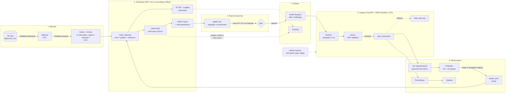

# Архитектура: этапы жизненного цикла и технологии

Документ для подготовки к собеседованию. Для каждого компонента: что он делает в проекте, почему выбран и где лежит код.

## Схема



Последовательность «один оборот цикла» (по симуляции):

```
день 90   сдвиг: появилась тема REFUND (25% трафика), 75% текстов разговорные/с опечатками
день 97   Evidently: 2 дневные проверки подряд с дрейфом → алерт → DAG retrain
день 104  операторы разметили свежие обращения (SLA 7 дней) → train → gate → challenger
день 107  shadow 3 дня: кандидат отвечает в лог, расхождение с production 23%
день 111  canary 4 дня, 20% трафика: точность canary 1.00 vs production 0.75 → promote
```

## Компоненты

### DVC — версии данных
- **Что делает.** Пайплайн `download → prepare → simulate` описан в [dvc.yaml](../dvc.yaml), параметры лежат в [params.yaml](../params.yaml). Сырой CSV и parquet-файлы версионирует DVC. В git попадают только хеши (`dvc.lock`), сами данные туда не идут. `dvc repro` пересобирает только те стадии, у которых изменились зависимости или параметры.
- **Почему.** Модель воспроизводима только в связке «код + данные + параметры». DVC связывает версию разметки с git-коммитом, а MLflow логирует те же параметры. Альтернатива — LakeFS, но для одного разработчика это тяжеловато.
- **Где.** [dvc.yaml](../dvc.yaml), загрузка в `download_raw` ([data.py:34](../src/ticketflow/data.py)).

### Данные и сценарий сдвига
- **Что делает.** Берёт публичный датасет Bitext customer support, переведённый на русский: 11 тем, 18k уникальных текстов. Строит из него «историю» (2500 обращений, на ней обучается первая модель) и поток на 180 дней по 50 обращений в день. В месяце 3 включается сдвиг. Тема REFUND, которой раньше не было, вырастает до 25% трафика. Доля разговорных текстов и текстов с опечатками (флаги датасета Q и Z) растёт с 10% до 75%. Сдвиг нарастает линейно в течение 7 дней.
- **Почему так.** Сдвиг строится из реальных текстов, без генерации, и полностью контролируется параметрами. Каждый текст используется один раз, поэтому утечки между днями нет. Тема REFUND есть в таксономии с первого дня, поэтому голова классификатора не меняется. Это упрощает ONNX-экспорт и сравнение моделей по классам.
- **Где.** `build_stream` ([data.py:101](../src/ticketflow/data.py)), `_shares` ([data.py:92](../src/ticketflow/data.py)).

### scikit-learn — baseline
- **Что делает.** TF-IDF по словам и символьным n-граммам плюс LogisticRegression. Обучается при каждом переобучении, его macro-F1 логируется в MLflow рядом с трансформером.
- **Почему.** Нижняя планка: трансформер должен оправдывать свою стоимость. На этих данных baseline почти не уступает трансформеру (см. README). Это честный вывод, и его стоит проговаривать на собеседовании.
- **Где.** [models/baseline.py](../src/ticketflow/models/baseline.py).

### PyTorch — обучение rubert-tiny2
- **Что делает.** `cointegrated/rubert-tiny2` (29M параметров) и линейная голова на [CLS]. Цикл обучения написан вручную, без HF Trainer: AdamW с раздельным weight decay, линейный warmup и косинусное затухание через `LambdaLR`, AMP (fp16 autocast + GradScaler), gradient clipping. Loss по эпохам уходит в MLflow. Обучение на RTX 4060 Ti занимает около 22 с.
- **Почему.** Свой цикл показывает, что я понимаю устройство обучения: оптимизатор, расписание LR, смешанную точность. rubert-tiny2 быстрая и подходит для CPU-инференса.
- **Где.** `TicketClassifier` ([transformer.py:34](../src/ticketflow/models/transformer.py)), `train_transformer` ([transformer.py:73](../src/ticketflow/models/transformer.py)).

### ONNX / ONNX Runtime — инференс на CPU
- **Что делает.** Модель экспортируется через `torch.onnx.export(dynamo=True)` с динамическими batch и seq и двумя выходами: logits и эмбеддинг (эмбеддинг нужен для мониторинга дрейфа). Затем применяется динамическая int8-квантизация (`onnxruntime.quantization.quantize_dynamic`). Сервис запускает int8-граф через `tokenizers` и `onnxruntime`. Torch в образе сервиса нет, образ весит 640 МБ.
- **Подводные камни, которые пришлось решить.** (1) Пример для экспорта с batch=1 «специализирует» размерность. Нужен пример хотя бы из двух строк. (2) Квантизатор ORT падал на `value_info`, которую записал dynamo-экспортёр. Помогает очистить `value_info` перед квантизацией. (3) Имя выхода `embedding` конфликтовало с внутренним узлом графа.
- **Где.** `export_onnx` / `quantize_int8` ([transformer.py:182](../src/ticketflow/models/transformer.py)), `OnnxPredictor` ([inference.py:25](../src/ticketflow/inference.py)), замер в [benchmark.py](../src/ticketflow/benchmark.py).

### Ворота качества (quality gate)
- **Что делает.** Кандидат и текущий production оцениваются на одном и том же golden-наборе: это отложенные 40% свежей разметки за 30 дней, около 300 обращений. Кандидат проходит, если выполнены три условия: (1) macro-F1 не ниже 0.70; (2) macro-F1 не хуже production больше чем на 0.005; (3) F1 ни одного класса с поддержкой от 15 примеров не просела больше чем на 8 п.п.
- **Почему.** Только macro-F1 недостаточно: улучшение на новой теме может скрыть провал старой. Порог по поддержке нужен потому, что на 10 примерах одна ошибка уже даёт −10 п.п., а это шум. Пороги подобраны после первого прогона, где golden-набор был около 100 примеров и ворота «мигали» на чистой разметке.
- **Проверка.** На «учениях» обучены 6 кандидатов. Все 3 систематические подмены классов остановлены, чистая разметка прошла. 10% случайных переворотов меток прошли, и это корректно: модель от них не стала хуже.
- **Где.** [gate.py](../src/ticketflow/gate.py), `gate_and_register` ([pipeline.py:159](../src/ticketflow/pipeline.py)), учения `_gate_drill` ([simulate.py:280](../src/ticketflow/simulate.py)).

### MLflow — трекинг и Model Registry
- **Что делает.** Каждый кандидат — это run с параметрами, кривой loss, метриками трансформера и baseline, F1 по классам, распределением классов в train и `gate.json`. Прошедший ворота кандидат логируется как pyfunc-модель (ONNX-бандл лежит внутри artifacts) и регистрируется новой версией. Жизненный цикл ведётся через **алиасы**: `challenger → production`, при этом старый production получает алиас `previous`. Stages в MLflow 3 устарели.
- **Почему.** Реестр — единственный источник правды о том, что сейчас в production. Сервис, Airflow и CLI смотрят в одно место. Откат — это перенос алиаса, а не пересборка образа.
- **Инфраструктура.** На стенде backend store — Postgres, артефакты отдаются через сам MLflow server (`--serve-artifacts`), поэтому клиентам не нужны S3-ключи. Симуляция использует отдельную одноразовую sqlite-базу, чтобы прогоны были воспроизводимы.
- **Где.** [registry.py](../src/ticketflow/registry.py): `promote`, `rollback`, `download_bundle`.

### FastAPI-сервис: shadow и canary
- **Что делает.** При старте загружает `models:/ticket-router@production` и `@challenger`. Логика маршрутизации вынесена в класс `Router` без веб-фреймворка, и этот же класс используется в симуляции. Режимы:
  - `shadow`: отвечает production, кандидат считается молча, совпадения уходят в Prometheus;
  - `canary`: доля трафика уходит кандидату, назначение «липкое», по sha1 от ticket_id, чтобы один клиент не прыгал между моделями.
  
  `/feedback` принимает финальное решение оператора и превращает его в онлайн-точность по версиям. `/admin/reload` перечитывает алиасы. Фоновый поллер раз в 30 с делает то же самое как страховку.
- **Где.** [router.py](../src/ticketflow/router.py), [serving/app.py](../src/ticketflow/serving/app.py).

### Evidently — дрейф
- **Что делает.** Для каждого обращения сервис пишет признаки, для которых не нужны метки: длину, число слов, долю слов вне словаря обучения (OOV), уверенность модели, 5 главных компонент эмбеддинга (PCA-базис считается на обучении) и предсказанный класс. Evidently сравнивает окно из последних 5 дней с референсом. Референс — это признаки свежего трафика, который не попал в обучение, посчитанные самой production-моделью и сохранённые в бандле. Числовые признаки проверяются KS-тестом при p < 0.01, класс — chi-square. Алерт поднимается, если дрейфует 40% признаков или распределение предсказаний (p < 1e-4), и при этом условие держится **2 проверки подряд**.
- **Почему так.** Метки приходят с задержкой, а дрейф входа виден сразу. Пороги откалиброваны на «спокойных» месяцах 0–2. Без правила «2 подряд» было 2 ложных алерта за 90 дней, с ним — 0, ценой одного дня задержки. Это осознанный компромисс между ложными тревогами и скоростью реакции.
- **Где.** [drift.py](../src/ticketflow/drift.py), онлайн-версия по логу сервиса — [monitor.py](../src/ticketflow/monitor.py).

### Airflow — оркестрация
- **Что делает.** Два DAG'а:
  - `drift_monitor` (каждые 2 мин, это «день» на демо-стенде): проверка Evidently по логу → отправка `ticket_drift_share` в сервис → `short_circuit`, если алерта нет или кандидат уже выкатывается → `TriggerDagRunOperator(retrain)`;
  - `retrain`: `fetch_labels → train → quality_gate (short_circuit) → shadow → canary → promote → release`. `release` выполняется всегда (`trigger_rule=all_done`): снимает непрошедшего кандидата, возвращает сервис в режим «только production» и удаляет lock-файл, который `drift_monitor` ставит, чтобы на один алерт был ровно один запуск. Shadow и canary читают дельты счётчиков `/metrics` сервиса за своё окно. Если порог нарушен, задача падает, режим сбрасывается в `off`, и production не меняется.
- **Почему.** Задачи DAG'а — тонкие обёртки над теми же функциями, что вызывает симуляция. Логика тестируется без Airflow, а Airflow отвечает за расписание, повторы, историю запусков и длительности шагов. Запуск: Airflow 3.3 `standalone` + LocalExecutor + Postgres, без Celery и Redis, чтобы сэкономить память. Контейнеру проброшен GPU (`deploy.resources.reservations.devices`), torch — та же CUDA-сборка, что в venv хоста; без GPU обучение автоматически идёт на CPU.
- **Где.** [dags/drift_monitor.py](../dags/drift_monitor.py), [dags/retrain.py](../dags/retrain.py).

### Prometheus + Grafana
- **Что делает.** Сервис отдаёт счётчики предсказаний по версиям и плечам, гистограммы задержки и уверенности, счётчики совпадений shadow, онлайн-точность по обратной связи, а также `ticket_drift_share` и `ticket_model_info`. Дашборд Grafana подтягивается из provisioning: точность по версиям, дрейф, трафик по плечам, согласие shadow, p50/p95, распределение классов.
- **Где.** [docker/prometheus.yml](../docker/prometheus.yml), [docker/grafana/provisioning](../docker/grafana/provisioning).

### CI/CD — GitHub Actions
- **Что делает.** `test`: ruff и pytest (ворота, роутер, дрейф, данные). `gate`: запускается вручную или по `[train]` в коммите, обучает модель и падает с кодом 3, если ворота не пройдены. `image`: собирает образ сервиса и пушит его в GHCR с main.
- **Где.** [.github/workflows/ci.yml](../.github/workflows/ci.yml).

### Docker Compose
- Postgres (MLflow + Airflow), MLflow server, сервис, Airflow, Prometheus, Grafana: [compose.yaml](../compose.yaml).
- **Отклонение от плана:** MinIO не используется. Официальный образ `minio/minio` больше не публикуется в Docker Hub, поэтому артефакты хранит и проксирует MLflow server на томе. Чтобы перейти на S3 или MinIO, достаточно поменять флаг `--artifacts-destination s3://...`. Код клиентов не меняется.

## Вопросы, которые стоит ожидать

- *Почему алиасы, а не stages?* Stages устарели в MLflow 2.9+. Алиасов может быть сколько угодно, и они явно задают роль версии (`challenger`, `previous`).
- *Как ворота защищают от плохой разметки, если golden тоже размечен людьми?* Golden — это отложенная часть разметки. В реальности её перепроверяет старший оператор, и она никогда не попадает в обучение. В учениях портится только train, golden остаётся чистым.
- *Зачем shadow, если есть ворота?* Ворота проверяют модель офлайн на 300 примерах. Shadow проверяет её на живом трафике без риска для клиента: что модель загружается, не падает и расходится с production в разумных пределах. Canary проверяет её по реальной обратной связи.
- *Почему сервис на CPU?* rubert-tiny2 в int8 даёт задержку в единицы миллисекунд (см. бенчмарк). GPU для такого трафика — это лишние деньги.
- *Что будет в реальности иначе?* Метки приходят с задержкой и выборочно. Canary нужно сравнивать по прокси-метрикам (уверенность, ручные переназначения тикетов), а не по полной разметке. Вместо «полгода за час» дрейф накапливается неделями.
